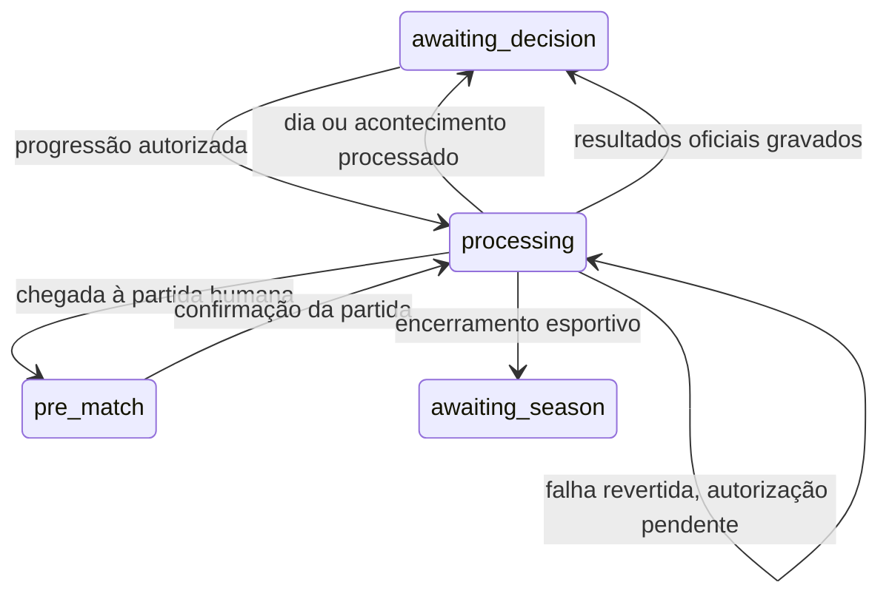

# Competições, calendário e progressão temporal — Entrega 06

## Usar na aplicação

Execute `php artisan migrate --seed` na conexão de desenvolvimento. Na nuvem, ative antes `source /workspace/.cloud-tools/football-env.sh`. A migração também prepara carreiras existentes, preservando seus universos e datas.

O dashboard mostra data interna, próxima partida, dias restantes, classificação, artilharia e calendário com links para os resultados oficiais. **Próxima partida** é a ação principal: processa os dias intermediários e para no pré-jogo. **Avançar 1 dia** e **Próximo acontecimento** são alternativas. Nenhuma delas inicia a partida do usuário.

No dia do jogo, escolha **Jogar partida**, revise a escalação e as táticas e pressione **Confirmar e jogar partida**. É necessário ter uma escalação salva e válida, substituindo atletas suspensos ou indisponíveis. O resultado mostra eventos, estatísticas e condição física aplicada. Os demais confrontos da mesma data também são concluídos nessa confirmação. A data permanece no dia da partida até uma nova progressão.

Após as 18 rodadas, **Próximo acontecimento** encerra esportivamente a temporada, no dia seguinte à última data do calendário. O dashboard conserva campeão, classificação e artilharia finais. A criação da temporada seguinte pertence à Entrega 10.

## Calendário e acontecimentos

Cada carreira mantém `current_date`, estado e `progression_revision` próprios. A liga inicial usa a geração de turno/returno da Entrega 02: dez clubes, 18 rodadas, 90 confrontos distintos, nove mandos e nove visitas por clube. As rodadas ficam separadas por sete dias, conforme `config/careers.php`.

`CareerCalendar` identifica a próxima partida humana e os acontecimentos relevantes pendentes. `career_events` guarda chave única por carreira, temporada, tipo, data, título, necessidade de confirmação, estado e data de processamento. A criação da carreira e a migração das existentes registram o encerramento da temporada.

Tipos iniciais:

- `season_end`: encerra a temporada somente quando todas as partidas possuem resultados oficiais.
- `administrative_decision`: interrompe qualquer avanço na sua data; o dashboard exige confirmação de ciência antes de continuar. São avisos administrativos cadastrados pelo backend, sem execução de investimentos ou outras decisões financeiras.
- `notice`: informativo, processado na data correspondente sem interromper a modalidade **Próximo acontecimento**.

A próxima partida humana também é um acontecimento relevante. Recuperação física diária e jogos entre IAs não interrompem essa modalidade. Um avanço até uma partida posterior respeita todos os pontos obrigatórios anteriores. Se um aviso interromper uma data com jogos da IA, esses confrontos serão processados antes de sair dessa data, após a confirmação do aviso.

Obras, público, ingressos, finanças e engajamento serão integrados pelas Entregas 07–09. A conclusão de obra deverá registrar seu acontecimento e seu processador nessa integração; tipos sem processador geram falha, sem serem marcados artificialmente como concluídos. Esta entrega não cria cobranças nem mudanças de infraestrutura.

## Serviço e sequência diária

`Application/Careers/CareerProgressionService` disponibiliza:

| Ação | Comportamento |
| --- | --- |
| `ADVANCE_ONE_DAY` | Avança um dia, respeitando partidas e decisões pendentes. |
| `ADVANCE_TO_NEXT_MATCH` | Avança até o próximo compromisso humano; sem novos compromissos, até o próximo acontecimento relevante. |
| `ADVANCE_TO_NEXT_EVENT` | Avança até o primeiro entre próxima partida humana e acontecimento relevante. |
| `PLAY_MATCH` | Confirma especificamente a partida humana no pré-jogo atual e conclui os jogos agendados para a mesma data. |
| `ACKNOWLEDGE_EVENT` | Registra ciência do aviso administrativo pendente, sem avançar o dia. |

O endpoint é `POST /careers/{career}/progression`, autenticado e protegido por CSRF. Recebe `action`, `request_id` UUID e `revision` da carreira. `PLAY_MATCH` também exige `match_id`; `ACKNOWLEDGE_EVENT`, `event_id`. Datas, placares, saldo e condição física enviados pelo cliente não são usados como comandos.

O avanço percorre datas em ordem crescente. Cada dia novo registra uma linha única em `career_processed_days`, recupera a condição física e processa os acontecimentos aplicáveis. A recuperação inicial é de oito pontos por dia, limitada a 100 e configurável em `careers.daily_fitness_recovery`; atletas lesionados não recuperam até terminar a data de indisponibilidade, inclusive. Consultas e ações adicionais no mesmo dia não repetem a recuperação.

Em datas anteriores ao jogo humano, confrontos entre IAs são executados na data agendada e em ordem de ID. Na data do jogo humano, a carreira para em `pre_match`; os confrontos dessa data aguardam a confirmação, quando são executados em ordem de ID. Dias confirmados, efeitos físicos, resultados, acontecimentos e a nova data são gravados na mesma transação de execução.



## Resultados, classificação e artilharia

`PlayOfficialMatch` é uma etapa interna de uma operação autorizada e bloqueada. Usa os snapshots humanos confirmados, a IA da Entrega 05 e a versão do motor registrada na autorização. A seed deriva da chave persistida da carreira e do identificador do confronto, sem relógio real ou sorteio global.

`official_match_results` possui um resultado único por confronto, com data, placar, versão, seed, entrada completa, resultado e checksums. Os modelos bloqueiam atualização e exclusão. Chaves estrangeiras compostas impedem associar resultado, operação e partida de carreiras diferentes. Resultados oficiais ficam separados de `match_simulations`: amistosos continuam sem efeitos na competição ou nos jogadores.

A aplicação oficial usa a condição física final dos participantes e registra uma partida de suspensão por expulsão. Suspensões existentes diminuem quando o clube disputa uma partida oficial, enquanto os suspensos ficam fora do snapshot; não diminuem por avanço diário ou amistoso. Não há suspensão acumulada por amarelos nesta etapa. Em uma eventual interrupção, o motor informa `abandoned` e conserva o placar até a interrupção, sem inventar placar administrativo; os indicadores da competição usam esse placar registrado.

`StandingsService` reconstrói pontos, jogos, vitórias, empates, derrotas, gols pró, gols contra e saldo exclusivamente dos resultados oficiais da edição. Pontuação e desempates vêm das regras congeladas na criação da carreira. Pontos são comparados primeiro; os desempates suportados são vitórias, saldo, gols pró, gols contra (menor primeiro) e código do clube. Código e ID asseguram ordem estável em empates remanescentes. A configuração inicial é vitórias, saldo, gols pró e código. Critérios desconhecidos são rejeitados.

A artilharia soma os gols individuais dos resultados oficiais, com identidade e nome do snapshot. Empates são ordenados pelo ID do jogador. No encerramento autorizado, a aplicação verifica a quantidade esperada de resultados e a ausência de confrontos pendentes, marca edição e temporada como concluídas e congela campeão, classificação e artilharia em `career_seasons.summary`, com `ended_on`. O dashboard usa esses dados finais preservados.

## Idempotência, concorrência e recuperação

O processamento possui duas transações:

1. **Autorização:** bloqueia a carreira, valida proprietário, revisão, destino e decisões finais; persiste uma operação `pending` em `career_operations` e o estado `processing`. A confirmação humana congela sua escalação e táticas antes de liberar esse bloqueio.
2. **Execução:** readquire o bloqueio e executa somente o destino autorizado. Confirma todos os efeitos, incrementa a revisão e marca a operação `completed`. Uma falha reverte todos os efeitos dessa execução e preserva a autorização pendente.

Solicitações iguais retornam a mesma operação. Reutilizar um UUID com outro comando, partida, acontecimento ou revisão gera erro. Solicitações de abas com revisão antiga são rejeitadas. Enquanto uma operação estiver pendente, novas progressões, alterações de escalação e amistosos ficam bloqueados. MySQL usa bloqueio da linha da carreira; SQLite adquire o bloqueio de escrita antes de ler a revisão.

Se a requisição for interrompida depois da autorização, o dashboard mostra **Retomar operação autorizada**. O POST `/careers/{career}/operations/{operation}/resume` exige o proprietário e a operação da mesma carreira. Retoma o destino original, sem criar outra progressão. Operações concluídas podem ser repetidas sem reaplicar efeitos. Em falhas persistentes de dados ou infraestrutura, corrigir sua causa e usar a mesma retomada; não iniciar outra operação para contornar a reserva.

Não existem cron jobs, workers ou efeitos de login/GET que iniciem ou retomem progressões. O relógio real aparece apenas nos timestamps de auditoria. Fechar o navegador pode deixar a execução já autorizada concluir no servidor; ao voltar, a carreira terá o estado confirmado ou a autorização pendente, sem avanços adicionais.

## Migração e validação

A migração `2026_10_22_000005_create_career_progression` adiciona revisão da carreira, histórico final da temporada e tabelas de operações, dias processados, acontecimentos e resultados oficiais. Carreiras anteriores recebem apenas a revisão inicial e o acontecimento de encerramento; a data e os universos são preservados.

```bash
DB_CONNECTION=sqlite DB_DATABASE=:memory: php artisan test
```

- **110 testes aprovados em SQLite**, incluindo 18 novos cenários funcionais da Entrega 06.
- **90 testes funcionais aprovados em MySQL 8.0.46**, incluindo replay após persistência em JSON.
- Temporada completa nos dois bancos: 18 rodadas, 90 resultados únicos, efeitos físicos, classificação, artilharia e campeão; nenhuma nova temporada iniciada automaticamente.
- Concorrência real em SQLite e MySQL, com dois processos simultâneos por cenário: avanço e partida, com UUID igual e UUIDs distintos. Confirmada uma única aplicação de cada ação.
- Falhas injetadas durante avanços e após a gravação da partida humana: efeitos revertidos, autorização preservada e retomada sem duplicações.
- Fluxo HTTP real com cookies e CSRF: cadastro, 18 pré-jogos, revisão das escalações, confirmações, repetição segura, consulta após logout/login e encerramento esportivo.
- Atualização de carreira anterior, rollback e reaplicação da migração verificados em bancos descartáveis SQLite e MySQL.

Rollback remove os registros desta entrega e não desfaz datas ou efeitos físicos já aplicados. Use banco descartável para testar rollback; para desfazer uma implantação com progressões utilizadas, restaurar o estado completo correspondente.
